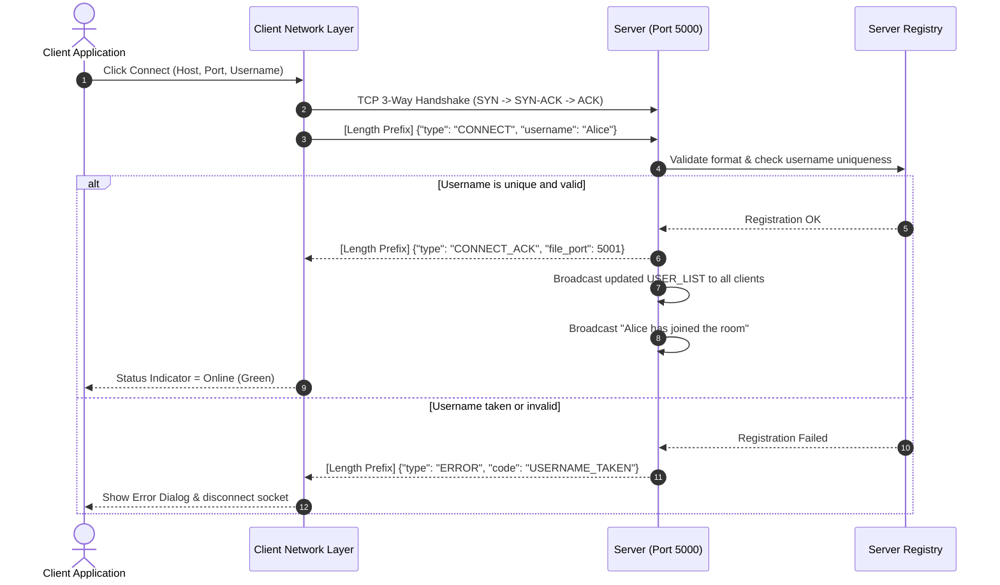
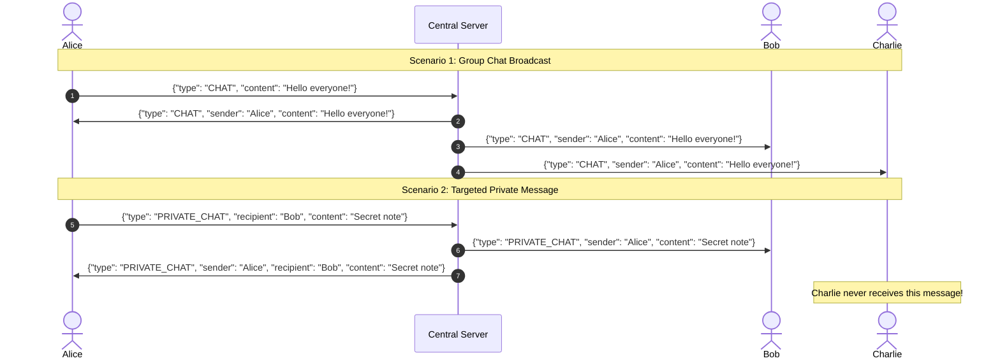
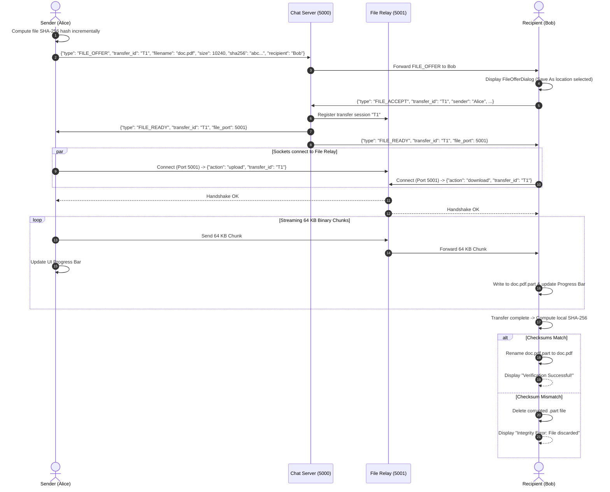

# System Architecture Documentation

**Project Title:** Design and Implementation of a TCP-Based Multi-Client Chat and File Sharing System  
**Subject:** Computer Networks (CN)  
**Architecture Style:** Centralized Client-Server Model  

---

## 1. High-Level Architecture Overview

The system uses a centralized **Client-Server Architecture** operating over the **TCP/IP protocol suite** at the Transport Layer (Layer 4) and Application Layer (Layer 7).

```
 [Desktop Client A] (Alice)            [Desktop Client B] (Bob)
         |                                     |
         +-----------------+-------------------+
                           | (Raw TCP - Port 5000/5001)
                           v
        +-----------------------------------------------+
        |           CENTRAL TCP SERVER                  |
        |     (Port 5000: Chat / Port 5001: Files)      |
        +-----------------------------------------------+
                           ^
                           | (Raw TCP Sockets via shared/protocol.py)
                           v
        +-----------------------------------------------+
        |        FLASK WEB BACKEND (GATEWAY)            |
        |      (Port 5050 - HTTP & Flask-SocketIO)      |
        +-----------------------------------------------+
                           |
            +--------------+--------------+
            | (WebSocket)                 | (HTTP GET/POST)
            v                             v
   [Browser Client C] (Charlie)    [File Upload / Download]
   HTML5 + CSS + Vanilla JS        Chunked Browser Transfers
```

### Key Architectural Decisions:
1. **Separation of Signaling and Bulk Data:**
   - **Port 5000 (Chat Signaling Socket):** Transmits lightweight JSON control messages (presence, chat broadcasts, private whispers, and file transfer invitations).
   - **Port 5001 (File Relay Socket):** Transmits binary data chunks (64 KB) directly between sender and recipient via the server.
   - *Why?* This eliminates Head-of-Line (HoL) blocking on the chat stream. A user sending a 50 MB file will not cause chat messages or online status updates to lag or stutter.

2. **Web-to-TCP Protocol Gateway (Port 5050):**
   - Bridges browser clients (using HTML5 WebSockets / Socket.IO) to the central TCP server (using raw TCP stream sockets with 4-byte length framing).
   - For each active browser user, the gateway instantiates an authentic Layer 4 TCP client socket session, allowing Web clients and Desktop clients to interact in the **same unified chat room**.
   - Preserves complete academic accuracy: WebSockets are recognized as Layer 7 full-duplex framed protocols over HTTP, while the server communication demonstrates true Layer 4 TCP socket programming.

3. **Thread-Safe Concurrency Model:**
   - **Multi-threading with Sockets:** Each connected client runs on a dedicated `ClientHandler` thread on the server.
   - **Snapshot Locking:** Shared state (`self.clients`) is protected using `threading.RLock()`. Broadcast iterations create shallow snapshots so that socket I/O is performed outside locks, preventing slow clients from freezing the server.
   - **Socket Write Locks:** Each client socket has a dedicated `threading.Lock()` so concurrent threads never interleave bytes on the same TCP socket.

4. **Decoupled GUI Threading:**
   - Tkinter runs on the **Main GUI Thread**. Sockets run on **Background Daemon Threads**.
   - Thread-safe `queue.Queue` delivers incoming network events to Tkinter's `root.after()` event loop. The UI never blocks or freezes during network latency or heavy transfers.

---

## 2. Component Hierarchy and Module Responsibilities

```
tcp-chat-file-sharing/
├── run_server.py                # Server launcher script
├── run_client.py                # Client GUI launcher script
├── run_demo_3clients.py         # Multi-client automated demo runner
├── requirements.txt             # Standard library dependencies documentation
├── .gitignore                   # Git hygiene and exclusion rules
│
├── shared/                      # Code shared across Server and Client
│   ├── __init__.py
│   ├── constants.py             # Buffer sizes, ports, message codes, limits
│   └── protocol.py              # Length-prefixed framing, JSON serialization, validation
│
├── server/                      # Server-side subsystem
│   ├── __init__.py
│   ├── main.py                  # CLI argument parsing, server entry point
│   ├── logger.py                # Thread-safe logging to stdout and logs/server.log
│   ├── server_core.py           # Central client directory, broadcast routing, lifecycle
│   ├── client_handler.py        # Per-client dedicated worker thread
│   └── file_transfer.py         # Secondary TCP file relay server
│
├── client/                      # Client-side subsystem
│   ├── __init__.py
│   ├── main.py                  # Desktop application entry point
│   ├── network.py               # Background TCP connection manager & event queue
│   ├── file_transfer.py         # Chunked upload/download worker with SHA-256 validation
│   ├── dialogs.py               # Tkinter modal dialogs (Offer, Accept/Save As, Send)
│   ├── ui.py                    # Modern dark theme Tkinter/ttk user interface
│   └── terminal_client.py       # Headless CLI client for terminal-only testing
│
├── tests/                       # Automated test suite
│   ├── test_protocol.py         # Tests for framing, coalescing, username validation
│   ├── test_file_transfer.py    # Tests for chunk hashing, sanitization, size limits
│   ├── test_server_integration.py # Multi-client integration & file relay verification
│   └── test_reliability.py      # Malformed inputs, hard disconnects, shutdown tests
│
└── docs/                        # College project documentation
    ├── architecture.md          # This architecture document
    ├── protocol.md              # Formal application wire protocol specification
    ├── test_cases.md            # Detailed test cases with execution results
    ├── viva_questions.md        # 20+ Viva questions and answers
    └── project_report.md        # Complete 20-section CN project report
```

---

## 3. Detailed Data Flow Diagrams

### A. Client Connection & Registration Flow



### B. Group vs. Private Message Routing



### C. File Transfer Flow with Relay & SHA-256 Verification



---

## 4. Concurrency and Thread Safety Analysis

| Component | Concurrency Model | Shared Resource | Protection Mechanism |
| :--- | :--- | :--- | :--- |
| **Server Client Registry** | Multi-threaded | `self.clients` dict | `threading.RLock()` re-entrant lock |
| **Client Socket Writers** | Multi-threaded | Individual socket descriptors | Per-client `threading.Lock()` write lock |
| **File Relay Sessions** | Multi-threaded | `self.sessions` dict | `threading.Lock()` lock |
| **GUI Updates (Tkinter)** | Event-driven single thread | Tkinter widgets | `queue.Queue` drained via `root.after()` |
| **File Upload/Download** | Background daemon threads | Local disk filesystem | Atomic `.part` file writing & renaming |

---

## 5. Security & Robustness Considerations

1. **Path Traversal Protection:**
   The `sanitize_filename()` function removes directory navigation tokens (`../`, `..\`) and OS reserved characters (`:`, `*`, `?`, `"`, `<`, `>`, `|`) preventing arbitrary directory writes.
2. **Buffer Overrun & Memory Protection:**
   - Messages are limited to `MAX_MESSAGE_SIZE` (10 MB).
   - Files are capped at `MAX_FILE_SIZE` (100 MB).
   - Files are read and written strictly in 64 KB chunks, preventing Out-Of-Memory (OOM) crashes on large files.
3. **Data Integrity Guarantee:**
   Every transferred file is hashed using **SHA-256** at the sender before transmission and verified byte-for-byte at the receiver before saving.
